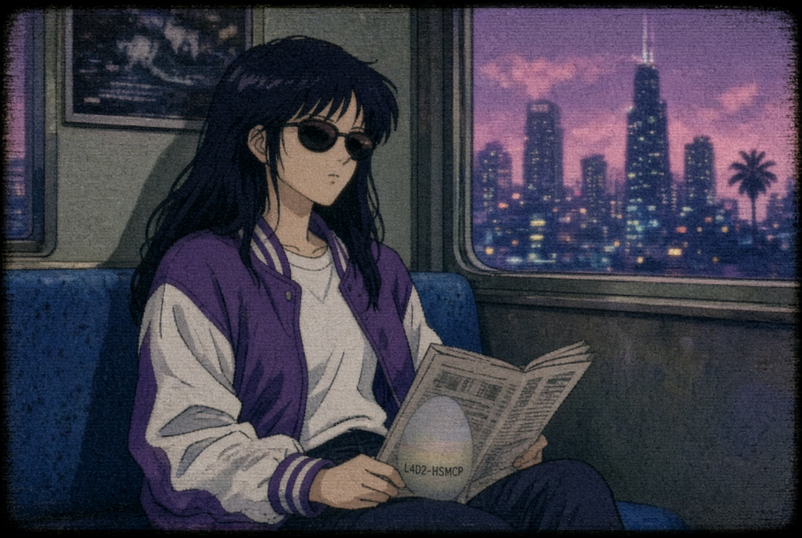

# L4D2-HSMCP

**Build Left 4 Dead 2 content with an AI agent.** Maps, campaigns, nav meshes, VScripts and
addons — through a purpose-built MCP server and a skill that teaches the agent how L4D2
actually works.

> **Alpha.** The project is under active development. Features, tool names and behaviour may
> change between `0.0.x` releases. Windows only. Left 4 Dead 2 only.
>
> **Licence compliance is mandatory.** Every borrowed code, FGD, model or data file must
> have a compatible licence and keep its copyright/permission notice. All borrowed code,
> licences and obligations live in [`third_party/`](third_party/README.md) — read
> [`third_party/NOTICES.md`](third_party/NOTICES.md) before importing anything.

  

## What it is

`L4D2-HSMCP` is a **skill and an MCP server for AI agents**: it gives an agent working hands in
Left 4 Dead 2 modding. The server provides the operations -- reading and writing the game's
files, building and checking content, compiling and packaging it -- and the companion skill
provides the knowledge of how that content has to fit together.

It is built for agents and usable by people: every operation is a described, checked tool, and
anything that writes asks for confirmation.

## Requirements

| Component | Why |
|---|---|
| **Left 4 Dead 2 Authoring Tools** (Steam app `563`) | the compilers (`vbsp`, `vvis`, `vrad`, `studiomdl`), Hammer and HLMV, and the FGD the tools validate against |
| **Hammer++ for L4D2** | the editor this toolkit is modelled on; the live-editor channel (`hammer_live_edit`, `hammer_menu`, `open_in_hammer`) needs it |
| **Tools++** | `vbsp++`/`vvis++`/`vrad++`/`bspzip++`; the compiler prefers this chain and falls back to the stock one, naming which ran |
| **Node.js 20+** and **pnpm 10+** | build and run the MCP server (tested on Node 24) |
| **Python 3.10+** | the `srctools` sidecar behind FGD, VPK, particles and parts of the VMF reader |
| **VTFEdit++ / VTFCmd** | texture conversion and the cubemap/skybox utilities |

Tools++ and VTFEdit++ unlock what they name rather than gate the project: without Tools++ the
compiler falls back to the stock chain and says so, and without VTFCmd texture conversion is
simply unavailable. The Authoring Tools, Node.js, pnpm and Python are needed for the server to
run at all.

## Credits

This project is built on work by others. The projects whose code or data it actually uses,
what exactly was taken, and the verbatim licence of each are recorded in
[`third_party/NOTICES.md`](third_party/NOTICES.md). Everything borrowed has been ported into
this repository and tested here; no other project's source tree is kept alongside ours.

## License

**GPL-3.0** — Copyright (C) 2026 **NexPG**.

Not affiliated with Valve Corporation. Left 4 Dead 2 and its content belong to Valve.
